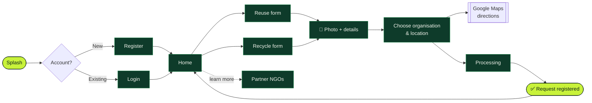
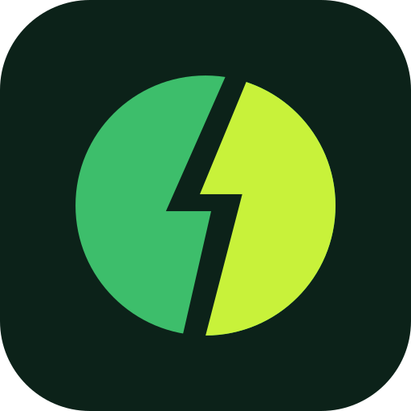

<div align="center">

<picture>
  <source media="(prefers-color-scheme: dark)" srcset="assets/brand/revolt-logo-dark.svg">
  <source media="(prefers-color-scheme: light)" srcset="assets/brand/revolt-logo-light.svg">
  
</picture>

### Transforming e‑waste into a sustainable future

An Android app that connects people holding old electronics with trusted organisations that **reuse** or **recycle** them.

<br>


[About](#-about) · [Features](#-features) · [How it works](#-how-it-works) · [Screens](#-screens) · [Getting started](#-getting-started) · [Structure](#-project-structure) · [Roadmap](#-roadmap)

</div>

---

## 🌱 About

Old phones, chargers and laptops usually end up in a drawer or a landfill. **ReVOLT** makes handing them on simple: sign up, choose whether the item should be **reused** or **recycled**, snap a photo, pick a partner organisation and get directions to drop it off.

The goal is to keep working parts in use, recover valuable materials such as copper and gold, and build awareness about responsible e‑waste disposal.

## ✨ Features

| | Feature | What it does |
|:-:|---|---|
| 🔐 | **Sign up & login** | Register with username, email, phone and password; validated input |
| ♻️ | **Reuse or recycle** | Two separate flows, each with its own form |
| 📸 | **Photo capture** | Take a picture of the device with the camera straight from the form |
| 🏢 | **Trusted organisations** | Profiles of partner NGOs: Greenpeace India, Navdanya, Aaranyak, Kalpavriksh |
| 🗺️ | **Drop‑off directions** | Enter your location and destination, open the route in Google Maps |
| ✅ | **Animated confirmation** | Lottie processing and success animations once a request is submitted |

## 🔄 How it works



1. Sign up or log in.
2. From the home screen, pick **Reuse** or **Recycle**.
3. Add the product name and description, and take a photo.
4. Choose a partner organisation, enter your location and get directions.
5. Submit — ReVOLT confirms the request.

## 📱 Screens

<table align="center">
  <tr>
    <td align="center"><br><sub><b>Register</b></sub></td>
    <td align="center"><br><sub><b>Home</b></sub></td>
    <td align="center"><br><sub><b>Item form</b></sub></td>
  </tr>
  <tr>
    <td align="center"><br><sub><b>Form with photo</b></sub></td>
    <td align="center"><br><sub><b>Location & directions</b></sub></td>
    <td align="center"><br><sub><b>Confirmation</b></sub></td>
  </tr>
</table>

## 🚀 Getting started

**Requirements:** Android Studio (Giraffe or newer), JDK 11+, an Android device or emulator running Android 7.0 (API 24) or later.

```bash
git clone https://github.com/spongebob2005/ReVOLT-Transforming-E-waste-into-Sustainable-Future.git
cd ReVOLT-Transforming-E-waste-into-Sustainable-Future
```

1. Open the folder in Android Studio and let Gradle sync.
2. Connect a device (or start an emulator).
3. Press **Run ▶** — or build from the terminal:

```bash
./gradlew assembleDebug
```

The APK lands in `app/build/outputs/apk/debug/`. Allow the **camera permission** when prompted so photo capture works.

## 🗂️ Project structure

```text
.
├── app/
│   └── src/main/
│       ├── java/com/example/revolt/   # Activities: splash, auth, forms, maps, confirmation
│       ├── res/layout/                # XML screens
│       ├── res/drawable/              # Icons, NGO logos, button backgrounds
│       ├── res/raw/                   # Lottie animations (delivery, tick)
│       └── AndroidManifest.xml
├── assets/brand/                      # ReVOLT logo (light, dark, icon)
├── ReVOLT/                            # Earlier copy of the Android project
├── *.jpg                              # README screenshots
└── build.gradle · settings.gradle
```

<details>
<summary><b>Screen → Activity map</b></summary>

<br>

| Screen | Activity | Layout |
|---|---|---|
| Splash | `Splash_Screen` | `splash_screen.xml` |
| Register | `MainActivity` | `activity_main.xml` |
| Login | `MainActivity2` | `activity_main2.xml` |
| Home | `MainActivity3` | `activity_main3.xml` |
| Reuse form | `MainActivity4` | `activity_main4.xml` |
| Recycle form | `MainActivity5` | `activity_main5.xml` |
| NGO profiles | `MainActivity6` – `MainActivity9` | `activity_main6.xml` – `activity_main9.xml` |
| Location & directions | `MainActivity10` | `activity_main10.xml` |
| Processing | `MainActivity12` | `activity_main12.xml` |
| Success animation | `MainActivity13` | `activity_main13.xml` |
| Confirmation | `MainActivity14` | `activity_main14.xml` |

</details>

## 🧭 Roadmap

- [x] Registration and login screens
- [x] Separate reuse and recycle flows with photo capture
- [x] Partner organisation profiles
- [x] Google Maps directions to drop‑off point
- [ ] Persist users and requests in a backend (e.g. Firebase)
- [ ] Pickup scheduling and request status tracking
- [ ] Dashboard of e‑waste collected by type and weight
- [ ] Awareness section on safe e‑waste handling

## 🤝 Contributing

Ideas and fixes are welcome.

1. Fork the repo and create a branch: `git checkout -b feature/your-idea`
2. Commit your changes: `git commit -m "Add your idea"`
3. Push and open a pull request.

---

<div align="center">



<sub>Made with 💚 by <a href="https://github.com/spongebob2005">Sameeran</a> · Give old electronics a second charge.</sub>

</div>
